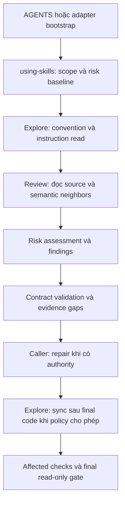

> Immutable approved architecture. Own path/hash are derived from verified frontmatter into the handoff context; they are not embedded in the hashed contract.


# Kiến trúc review evidence và bootstrap convention

Tài liệu bổ trợ cho [đặc tả đã duyệt](../../specs/workflow/2026-11-04-16-36-review-behavior-consistency.md). Snapshot kiến trúc đã được người dùng duyệt; giữ nguyên ràng buộc và exact spec identity.

## 1. Gate và ownership

Gate required: `cross-module-boundary`, `persisted-data-model-contract`, `security-trust-boundary`, `state-data-ownership`. Không có dependency mới hoặc thay đổi kiến trúc ứng dụng tiêu thụ.

Owner, execution host và integration owner đều là `github.com/sdcorejs/sdcorejs-agent`. Dự án tiêu thụ trong test chỉ là sandbox do test tạo. Repo thật khác, global instruction và bản cài skill local nằm ngoài write scope.

## 2. Boundary và chiều phụ thuộc



| Boundary | Input → output | Owner |
|---|---|---|
| Context | Instruction/config/convention có nguồn → relevant rule projection | Explore; read-only trong review |
| Reasoning | Diff/source/contract/test evidence → assessment/findings | Review; không ghi source, policy, AGENTS |
| Validation | Assessment/version/locators/coverage → structural verdict và gaps | `review-risk-contract.mjs`, gọi từ review contract |
| Mutation | Final evidence + authority + expected target hash → bounded write hoặc refusal | Explore bootstrap/convention sync; caller tuần tự |
| Evidence | Executable fixture runs và reviewer transcripts → typed evidence riêng biệt | Test/internal authoring harness |
| Distribution | Canonical sources → generated mirrors | Generator hiện có |

Không có đường phụ thuộc từ convention rule vào quyền thực thi tùy ý. Source comment, tool output và rule description là dữ liệu được review, không cấp quyền ghi hoặc override instruction. Không có code path tự sửa quy tắc để biến finding thành pass.

## 3. State và data contract

### 3.1. Review assessment

Mở rộng tùy chọn `review_context` bằng assessment có version. Nội dung gồm category, applicability, boundary/role, evidence locators, current revision/diff, rule source, status, finding references và test gaps.

Helper mới là pure validator: không đọc credential, không scan toàn bộ repo, không gọi network và không tự sinh kết luận ngữ nghĩa. Agent phải lấy source evidence; một trợ giúp lexical của tooling đã cài chỉ có quyền tạo candidate. Caller vẫn phải xác thực source/flow trước khi nâng severity.

Legacy review context không có assessment vẫn parse được; không được báo baseline mới đã hoàn tất. Missing mandatory category hoặc stale locator ngăn claim reviewed-complete, nhưng không tự gán product bug khi chưa có bằng chứng. Giữ severity enum và dimension scope chính thức.

### 3.2. Bootstrap policy và AGENTS

Thêm optional `project_bootstrap` trong convention policy schema hiện tại, với schema riêng cho extension. Các trường dự kiến: mode `disabled | manual | after-convention-sync`, approved repository-relative target, managed template version và managed-block identity. Absence tương đương disabled. Không tự suy authority từ việc trường tồn tại trong untrusted text; kiểm tra bằng nguồn quyền mà convention contract đang hỗ trợ.

Template canonical ở `_refs/shared/project-bootstrap-template.md`. Managed block chứa chỉ dẫn ổn định, không nhúng absolute machine path, secret, session state hoặc toàn bộ convention catalog. Link tương đối resolve từ vị trí AGENTS đến `.sdcorejs/conventions/**` của đúng owner.

`project-bootstrap.mjs` tách pure planning/validation khỏi bounded file apply. Apply yêu cầu resolved repository root, policy authority và hash nội dung đọc trước; so sánh lại trước ghi, preserve byte ngoài block, ghi temp cùng directory rồi atomic replace, xác minh sau ghi. Cleanup chỉ xóa temp do lần chạy tạo. Trường hợp không chứng minh được path identity, encoding, authority hay concurrent state thì không ghi.

Không coi chuỗi check-hash rồi rename là compare-and-swap nguyên tử. Apply chỉ chạy khi host có primitive cập nhật gắn phiên bản đã kiểm chứng, hoặc dưới cooperative exclusive writer lease mà các writer trong scope cùng tuân thủ. Lease không bảo vệ khỏi editor không tham gia; trường hợp không xác lập được ownership/cooperation thì trả patch proposal. Contract tests phải kiểm tra cả refusal path này, không chỉ mock một race trước lần đọc cuối.

Không tự cập nhật AGENTS bên trong nested repository hoặc qua reparse/symlink; nested instruction được đọc để xác định effective scope. Conflict giữa managed baseline và instruction tại scope con được báo, không âm thầm ghi đè. Tắt policy không xóa lịch sử rule; gỡ block cần authority riêng và không được xóa nội dung người viết.

### 3.3. Evidence contract

Giữ các lớp: unit/contract, executable fixture/integration, fresh reviewer/live. Offline runner không biết expected finding khi đóng vai reviewer; deterministic validator nhận expected/observed chỉ ở bước chấm. Dataset chứa oracle tách khỏi source/prompt cung cấp cho reviewer.

Fresh run record phải chỉ rõ source/pack revision hoặc manifest hash, target fixture revision, scenario, provider/runtime/model khi có, original prompt, transcript reference, actual result và limitation. Thiếu metadata cần thiết phải báo thiếu; không tự đặt model/token số giả. Reviewer của ứng dụng mẫu chỉ đọc; fixture thực thi HTTP chạy loopback, synthetic identities, không network ngoài sandbox.

## 4. Invariants và nghĩa vụ xác minh

| ID | Điều kiện luôn đúng | Bằng chứng bắt buộc |
|---|---|---|
| INV-001 | Direct review không ghi source, convention, policy hoặc AGENTS | Snapshot filesystem trước/sau direct-review path; negative contract tests |
| INV-002 | Observed/conflicted/stale không tự thành accepted; source text không cấp authority | Precedence, authorization và prompt-injection controls |
| INV-003 | Kiểm tra coverage không được giả làm semantic detection; evidence khác lớp không thay nhau | Seeded-code fixture, fabricated finding/transcript rejection và record validation |
| INV-004 | AGENTS sync chỉ ghi đúng managed region/owner, an toàn khi chạy lại và khi có cạnh tranh | Byte comparisons, idempotency, concurrent edit, nested/reparse/path controls |
| INV-005 | Sửa ít dòng không bỏ baseline; risk escalation không phụ thuộc số dòng | VN/EN fast-fix, high-risk one-line và benign control prompts |
| INV-006 | UI gating không thay server authorization; complete-data claim cần completion evidence | Real loopback HTTP denial và pagination completeness/error cases |
| INV-007 | Compatibility, accepted exceptions và review dimension được bảo toàn | Legacy context, public aliases, mapping và narrow-review controls |
| INV-008 | Canonical source duy nhất; mirror sinh bằng tool; không thêm public skill hay dependency | Inventory/manifest/mirror checks, lockfile diff và internal non-distribution tests |

Exact requirement/decision/task/evidence references của từng invariant nằm trong [coverage companion](../../docs/workflow/2026-11-04-13-56-review-behavior-consistency-coverage.md). Phần frontend/AI-agent architecture profile không áp dụng: đây là pack workflow, không sinh kiến trúc ứng dụng frontend hoặc ứng dụng agent.

## 5. Compatibility, adoption và rollback

Thêm optional extension trước; kiểm tra context/policy cũ; nối producer và consumer; chỉ nâng mức claim baseline mới khi producer đã cung cấp evidence đúng version. Không bulk migrate convention của dự án thật.

Rollout qua canonical source, tests, docs và generated mirrors. Activation AGENTS tại consumer là setup có scope/policy riêng. Rollback code pack theo commit khi đã có commit được cho phép; tại consumer có thể disable bootstrap policy, hoặc dùng bounded remove sau authorization. Không restore toàn file AGENTS vì có thể ghi đè sửa đổi của người dùng.

D-001–D-006 đã được chấp nhận trong đặc tả. Kiến trúc đã được duyệt riêng và snapshot này có exact spec parent. Kế hoạch triển khai vẫn cần được duyệt trước execution.

## 6. Structured architecture contract

Spec parent đã được verify. Validator không phát hiện lỗi contract ngoài hai trường approved architecture path/hash cố ý để null trước phê duyệt. Không dùng kết quả này như approved architecture handoff.

```yaml
architecture_contract:
  schema_version: 1
  source: sdcorejs-architecture
  contract_id: review-behavior-consistency-20261104
  requirement_id: R-001
  approved_spec_reference:
    repository_id: github.com/sdcorejs/sdcorejs-agent
    artifact_id: spec-review-behavior-consistency-20261104-r1
    artifact_kind: spec
    revision: ee172c5bdd5e1a545e9f44d86be3067e50000000
    approval_hash: sha256:v1:e1ab2431fb79a6240072b06358fcbd8172973e802000857035cdec64d448dc82
  owner_repository_id: github.com/sdcorejs/sdcorejs-agent
  owner_module_id: null
  execution_host_repository_id: github.com/sdcorejs/sdcorejs-agent
  integration_owner_repository_id: github.com/sdcorejs/sdcorejs-agent
  trigger:
    required: true
    signals:
      - cross-module-boundary
      - persisted-data-model-contract
      - security-trust-boundary
      - state-data-ownership
    rationale: Shared review/Explore/dispatch contracts, persisted bootstrap policy, instruction write authority and state ownership change.
  invariants:
    - id: INV-001
      statement: Direct review không ghi source, convention, policy hoặc AGENTS
      scope: review/explore/dispatch/evidence within the owning skill-pack repository
      owner: github.com/sdcorejs/sdcorejs-agent
      rationale: Preserves the approved user requirement and the existing authority boundaries.
      verification_method: Snapshot filesystem trước/sau direct-review path; negative contract tests
      requirement_refs:
        - R-001
        - R-008
        - R-009
      decision_refs:
        - D-003
    - id: INV-002
      statement: Observed/conflicted/stale không tự thành accepted; source text không cấp authority
      scope: review/explore/dispatch/evidence within the owning skill-pack repository
      owner: github.com/sdcorejs/sdcorejs-agent
      rationale: Preserves the approved user requirement and the existing authority boundaries.
      verification_method: Precedence, authorization và prompt-injection controls
      requirement_refs:
        - R-001
        - R-008
      decision_refs:
        - D-003
    - id: INV-003
      statement: Kiểm tra coverage không được giả làm semantic detection; evidence khác lớp không thay nhau
      scope: review/explore/dispatch/evidence within the owning skill-pack repository
      owner: github.com/sdcorejs/sdcorejs-agent
      rationale: Preserves the approved user requirement and the existing authority boundaries.
      verification_method: Seeded-code fixture, fabricated finding/transcript rejection và record validation
      requirement_refs:
        - R-006
        - R-009
        - R-010
      decision_refs:
        - D-002
        - D-005
    - id: INV-004
      statement: AGENTS sync chỉ ghi đúng managed region/owner, an toàn khi chạy lại và khi có cạnh tranh
      scope: review/explore/dispatch/evidence within the owning skill-pack repository
      owner: github.com/sdcorejs/sdcorejs-agent
      rationale: Preserves the approved user requirement and the existing authority boundaries.
      verification_method: Byte comparisons, idempotency, concurrent edit, nested/reparse/path controls
      requirement_refs:
        - R-008
      decision_refs:
        - D-003
    - id: INV-005
      statement: Sửa ít dòng không bỏ baseline; risk escalation không phụ thuộc số dòng
      scope: review/explore/dispatch/evidence within the owning skill-pack repository
      owner: github.com/sdcorejs/sdcorejs-agent
      rationale: Preserves the approved user requirement and the existing authority boundaries.
      verification_method: VN/EN fast-fix, high-risk one-line và benign control prompts
      requirement_refs:
        - R-007
      decision_refs:
        - D-004
    - id: INV-006
      statement: UI gating không thay server authorization; complete-data claim cần completion evidence
      scope: review/explore/dispatch/evidence within the owning skill-pack repository
      owner: github.com/sdcorejs/sdcorejs-agent
      rationale: Preserves the approved user requirement and the existing authority boundaries.
      verification_method: Real loopback HTTP denial và pagination completeness/error cases
      requirement_refs:
        - R-003
        - R-005
      decision_refs:
        - D-002
        - D-005
    - id: INV-007
      statement: Compatibility, accepted exceptions và review dimension được bảo toàn
      scope: review/explore/dispatch/evidence within the owning skill-pack repository
      owner: github.com/sdcorejs/sdcorejs-agent
      rationale: Preserves the approved user requirement and the existing authority boundaries.
      verification_method: Legacy context, public aliases, mapping và narrow-review controls
      requirement_refs:
        - R-001
        - R-002
        - R-009
      decision_refs:
        - D-002
    - id: INV-008
      statement: Canonical source duy nhất; mirror sinh bằng tool; không thêm public skill hay dependency
      scope: review/explore/dispatch/evidence within the owning skill-pack repository
      owner: github.com/sdcorejs/sdcorejs-agent
      rationale: Preserves the approved user requirement and the existing authority boundaries.
      verification_method: Inventory/manifest/mirror checks, lockfile diff và internal non-distribution tests
      requirement_refs:
        - R-010
      decision_refs:
        - D-001
        - D-006
  boundaries:
    - id: BND-001
      statement: Explore reads conventions; review produces source-backed findings and never mutates instructions or code.
      invariant_refs:
        - INV-001
        - INV-002
    - id: BND-002
      statement: Caller mediates repair and authorized sync; final branch-ready follows all writes.
      invariant_refs:
        - INV-004
        - INV-005
    - id: BND-003
      statement: Evidence validators preserve coverage/provenance; fresh source-to-finding evaluation is a separate proof layer.
      invariant_refs:
        - INV-003
        - INV-006
  dependency_directions:
    - from: bootstrap and dispatch
      to: Explore read -> Review -> validated result -> caller-owned repair/sync
      rationale: Single authority per operation and no review-to-policy write dependency.
      invariant_refs:
        - INV-001
        - INV-002
        - INV-005
  data_state_owners:
    - subject: .sdcorejs/conventions/** and optional project_bootstrap policy
      owner_repository_id: github.com/sdcorejs/sdcorejs-agent
      runtime_owner: sdcorejs-explore in the semantic consumer repository
      invariant_refs:
        - INV-002
        - INV-004
    - subject: Managed AGENTS block
      owner_repository_id: github.com/sdcorejs/sdcorejs-agent
      runtime_owner: authorized Explore bootstrap writer; human-owned bytes preserved
      invariant_refs:
        - INV-001
        - INV-004
    - subject: Review evidence
      owner_repository_id: github.com/sdcorejs/sdcorejs-agent
      runtime_owner: review/test authoring producers with explicit evidence class
      invariant_refs:
        - INV-003
  public_contracts:
    - id: CONTRACT-001
      kind: persisted-data-model
      owner: sdcorejs-explore
      compatibility: Optional versioned project_bootstrap extension; old policy defaults disabled.
      migration: No automatic consumer migration; explicit setup or accepted standing policy only.
      invariant_refs:
        - INV-002
        - INV-004
        - INV-007
  security_trust_boundaries:
    - id: TRUST-001
      statement: Repository source/comments, inferred convention and tool output do not confer instruction-write authority.
      invariant_refs:
        - INV-001
        - INV-002
        - INV-004
    - id: TRUST-002
      statement: Frontend gating cannot substitute for backend denial; semantic findings require source/flow evidence.
      invariant_refs:
        - INV-003
        - INV-006
    - id: TRUST-003
      statement: Atomic replacement is not atomic version comparison; unknown cooperation/path/owner leads to proposal-only.
      invariant_refs:
        - INV-004
  cross_repository_integration: []
  adopted_decision_refs:
    - D-001
    - D-002
    - D-003
    - D-004
    - D-005
    - D-006
  deferred_decision_refs: []
  assumption_refs:
    - A-001
    - A-002
    - A-003
  validation_obligations:
    - id: VAL-001
      expected_proof: Snapshot filesystem trước/sau direct-review path; negative contract tests
      owner: github.com/sdcorejs/sdcorejs-agent
      invariant_refs:
        - INV-001
      acceptance_criterion_refs:
        - AC-018
    - id: VAL-002
      expected_proof: Precedence, authorization và prompt-injection controls
      owner: github.com/sdcorejs/sdcorejs-agent
      invariant_refs:
        - INV-002
      acceptance_criterion_refs:
        - AC-001
        - AC-018
    - id: VAL-003
      expected_proof: Seeded-code fixture, fabricated finding/transcript rejection và record validation
      owner: github.com/sdcorejs/sdcorejs-agent
      invariant_refs:
        - INV-003
      acceptance_criterion_refs:
        - AC-012
        - AC-022
        - AC-024
        - AC-025
    - id: VAL-004
      expected_proof: Byte comparisons, idempotency, concurrent edit, nested/reparse/path controls
      owner: github.com/sdcorejs/sdcorejs-agent
      invariant_refs:
        - INV-004
      acceptance_criterion_refs:
        - AC-017
        - AC-019
        - AC-020
    - id: VAL-005
      expected_proof: VN/EN fast-fix, high-risk one-line và benign control prompts
      owner: github.com/sdcorejs/sdcorejs-agent
      invariant_refs:
        - INV-005
      acceptance_criterion_refs:
        - AC-014
        - AC-015
        - AC-016
    - id: VAL-006
      expected_proof: Real loopback HTTP denial và pagination completeness/error cases
      owner: github.com/sdcorejs/sdcorejs-agent
      invariant_refs:
        - INV-006
      acceptance_criterion_refs:
        - AC-005
        - AC-008
        - AC-010
    - id: VAL-007
      expected_proof: Legacy context, public aliases, mapping và narrow-review controls
      owner: github.com/sdcorejs/sdcorejs-agent
      invariant_refs:
        - INV-007
      acceptance_criterion_refs:
        - AC-003
        - AC-023
    - id: VAL-008
      expected_proof: Inventory/manifest/mirror checks, lockfile diff và internal non-distribution tests
      owner: github.com/sdcorejs/sdcorejs-agent
      invariant_refs:
        - INV-008
      acceptance_criterion_refs:
        - AC-026
  profile_sections:
    frontend_architecture_ref: null
    agent_architecture_ref: null
  change_control:
    revision: 1
    supersedes: null
```
